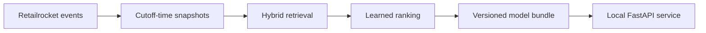

# E-commerce recommendation system

A recommendation pipeline built on **2.76 million Retailrocket events**, from
chronological offline evaluation to hybrid retrieval, learned ranking and a
verified local FastAPI service. Retrieval quality, ranking gains and runtime
reliability are measured separately.

**Python 3.13 · NumPy/SciPy · pandas/Parquet · implicit ALS · FastAPI · Docker · GitHub Actions**

[Results](#measured-results) · [Architecture](#how-it-works) ·
[API](#model-artifacts-and-api) · [Reproduce](#reproduce)

## Try the demos

| Demo | What you can explore |
| :--- | :--- |
| **[RecoLens — model explorer](https://ecommerce-recsys.vercel.app/)** | Five precomputed examples from the actual Retailrocket model, with learned/RRF ordering and retrieval-source evidence. |
| **[RecoMe — shopping illustration](https://shoprecome.vercel.app/)** | Browse 100 photographed sample products, express preferences and receive explained browser-side suggestions. Its policy is independent of the Retailrocket model. |

The model API runs locally. Neither public website calls the backend.

## Measured results

### Ranking on the same candidate pool

Learned ranking found **952 additional targets in the Top-20**, a **41.7% relative
HR@20 improvement** over reciprocal rank fusion (RRF), without changing the pool.

| Ordering | Hits@20 | HR@20 | NDCG@20 |
| :--- | ---: | ---: | ---: |
| Hybrid RRF | 2,285 | 0.038518 | 0.018597 |
| Hybrid + learned ranker | **3,237** | **0.054566** | **0.026383** |

Both rows use the same **59,323 warm user-windows** in rolling folds 5–9 and
up to 1,000 candidates per request. All targets remain in the denominator;
rates are fractions in `[0, 1]`.

### Candidate availability

Retrieval is evaluated before ranking on the same warm cohort. Candidate
Recall@N measures whether the target enters the requested pool; it sets the
availability ceiling for the downstream ranker.

| Candidate generator | Recall@100 | Recall@1000 |
| :--- | ---: | ---: |
| Exact ALS | 0.050705 | 0.109216 |
| Five-source hybrid RRF | 0.079750 | 0.211537 |
| Hybrid without ALS | 0.081183 | 0.213206 |

The no-ALS ablation has slightly higher candidate recall. The locked serving
reference instead follows a development rule prioritizing complete-policy
Top-20 accuracy. Retrieval recall, ranking accuracy and operating cost are
separate decisions. [Retrieval report](docs/CANDIDATE_RETRIEVAL_REPORT.md) ·
[Policy trade-offs](docs/MODEL_POLICY_REPORT.md)

**Evaluation boundary:** all quality figures above use 59,323 warm user-windows
in folds 5–9, with unreachable targets retained. Folds 1–4 support development
and selection. Folds 5–9 had already been inspected before configuration lock,
so they are **post-selection diagnostics, not blind validation**. Cold users
are evaluated separately; these figures do not establish online business impact.

### Local HTTP verification

The selected Windows indexed-reader profile uses the original sealed model,
cache off and one active inference worker. The fixed steady sample offers
120 requests at 1/s: 100 warm references and 20 cold requests.

| Check | Observed result |
| :--- | ---: |
| Exact reference-output parity | 101/101 before and after restart |
| Steady successful requests | 120/120 |
| Successful warm HTTP p95 / p99 | 209.440 / 233.063 ms |
| Maximum loaded serving-process RSS | 1.499 GiB |

Burst/recovery, invalid startup, early shutdown and owned stop/restart checks
also pass. These are fixed local reference-workload results, not a production
SLO. Earlier Linux measurements use the original reader and retain their memory
budget failure; the indexed reader has not received Linux load qualification.
[Local release report](docs/LOCAL_RELEASE_REPORT.md)

## How it works



### Data and temporal evaluation

Retailrocket records views, cart additions and purchases from **1,407,580
visitors** across **235,061 items**. Identifiers are anonymized; the dataset has
no recognizable product names or photographs, which is why the shopping
illustration uses a separate sample catalog.

A global cutoff bounds every fold's training interactions, eligible items,
category metadata and recent-popularity window. Warm evaluation predicts each
returning user's first previously unseen item in the next window. First-time
users form a separate cold cohort. Repeated events remain available as implicit
feedback; unobserved products are not treated as confirmed dislikes.

Across nine folds, the benchmark contains **90,107 warm user-window targets**
and **1,262,289 cold targets**. These full-protocol totals differ from the
five-fold quality denominator above. [Dataset and assumptions](docs/DATASET_CARD.md) ·
[Rolling protocol](docs/ROLLING_EVALUATION_PROTOCOL.md)

### Retrieval and learned ranking

Five complementary sources generate candidates: ItemKNN, exact implicit ALS,
category popularity, global popularity and recent popularity. Each direct source
applies catalog and full-history seen filtering; an unavailable source returns
an empty pool. Popularity is an explicit source with its own attribution.
RRF merges the lists while retaining per-source scores and ranks.

The ranker is a deterministic pairwise linear model over **32 cutoff-time
features**, including user/item activity, category affinity and retrieval
evidence. Positive targets are paired with hard and sampled negatives from the
same request. Feature scaling uses training data only, and chronological
training on earlier folds precedes development scoring. Label fields remain
separate from predictors; zero-positive requests stay in evaluation.

The selected warm route uses full-hybrid candidates and learned ordering.
Cold requests use recent popularity. Configurations are locked on development
data before later diagnostics, with score/item-ID tie-breaking and explicit
seeds/thread settings. [Ranking design and results](docs/LEARNED_RANKING_REPORT.md)

### Experiments and adoption decisions

| Experiment | Outcome |
| :--- | :--- |
| [PyTorch Two-Tower](docs/TWO_TOWER_REPORT.md) | Exact neural retrieval evaluated against ALS; recall trade-offs depend on candidate budget. It remains separate from the selected hybrid. |
| [Faiss HNSW](docs/ANN_RETRIEVAL_REPORT.md) | Four paired fold-1 pilot configurations failed the predefined speed gate; no ANN source was adopted. |
| [Sequential retrieval](docs/SEQUENTIAL_RECOMMENDATION_REPORT.md) | Recency-weighted transitions failed the matched Recall@100 improvement gate; the source was not added to the hybrid. |
| [Category re-ranking](docs/DIVERSITY_RERANKING_REPORT.md) | Increased distinct-category variety with relevance trade-offs; retained as an evaluated option outside the default route. |

### Model artifacts and API

Fitted snapshots are exported to safe NumPy, Parquet and JSON formats with a
complete inventory, external manifest pin and reference outputs. The package
loader restores inference without raw datasets, training scripts or fit calls;
it still requires compatible implementations and numerical dependencies.
The indexed reader reduces Python-object overhead while preserving the sealed
model's finite same-host traces.

| Endpoint | Purpose |
| :--- | :--- |
| `POST /v1/recommendations` | Top-1–20 recommendations for a stored snapshot user or the explicit cold route |
| `GET /health/live` | Process liveness |
| `GET /health/ready` | Verified model readiness |
| `GET /metrics` | Bounded-cardinality Prometheus telemetry |

An example cold-route request body is:

```json
{"k": 5}
```

Known users supply their snapshot `user_id` as a string. Responses expose the
ordered items, selected route, bundle version, historical cutoff and manifest
identity. Requests cannot inject new history or override the model policy.

Strict input/access guards and one active numerical worker bound admission.
Cancelling an HTTP waiter does not release computation still owned by that
worker. Cache is off by default; optional TTL/LRU caching and an explicitly
attributed overload fallback have separate limits and failure rules.
Structured events and metrics separate HTTP completion, worker outcomes,
cache behavior and resource measurements.
[Bundle contract](docs/MODEL_ARTIFACTS.md) · [API contract](docs/RECOMMENDATION_API.md) ·
[Observability](docs/OBSERVABILITY.md)

### Testing and release engineering

The recorded Windows checks pass **1,400 unit tests** and **14 fitted-process
integration tests**, with three Windows symlink-privilege skips. Integration
fixtures actually fit, export, reload and serve small models. Current-source
checks also use an independent source export and fresh Conda dependency install.
Real Retailrocket
bundle qualification is a separate explicit profile; missing real inputs fail
rather than being replaced by fixtures. JavaScript suites cover both demos.

CI uses immutable Action pins and hashed Linux CPU dependencies. Separate
network-isolated exercises cover candidate verification, release activation,
journal recovery, rollback and owned cleanup. The protected remote
real-qualification lane remains unconfigured; the published exercise evidence
is local. [Testing strategy](docs/TESTING_AND_RELEASE_GATES.md) ·
[Release workflow](docs/RELEASE_WORKFLOW.md)

## Repository layout

```text
src/ecommerce_recsys/
  data/             Input contracts, temporal splits and as-of catalogs
  recommendation/   Baselines, ItemKNN and matrix factorization
  retrieval/        Direct, hybrid, neural and sequential candidate sources
  ranking/          Snapshot features and category re-ranking
  evaluation/       Metrics, cohorts and artifact validation
  artifacts/        Versioned bundles and inference readers
  serving/          HTTP boundary, cache, access guards and telemetry
scripts/            Training, benchmark and verification entry points
tests/              Unit, fitted integration and JavaScript checks
benchmarks/         Versioned manifests, results and verification evidence
docs/               Designs, protocols, reports and operational guides
```

## Reproduce

Preview RecoLens from a checkout with Python 3.13; no dataset, model bundle or
cloud account is needed:

```sh
python scripts/verify_project_documentation.py
python -m http.server 8765 --bind 127.0.0.1 --directory demo
```

Open [localhost:8765](http://127.0.0.1:8765/) and stop the server with Ctrl+C.
For the shopping preview, serve `shop-demo/` on port 8766 instead.

The [reproduction guide](docs/REPRODUCIBILITY.md) covers dependency installation,
Python/JavaScript tests and historical experiment revisions. The
[local API guide](docs/LOCAL_DEMONSTRATION.md) covers real inference, which
requires the external model bundle and matching numerical dependencies.
Raw CSVs, prepared datasets and generated model files stay outside Git.

## Technical documentation

| Start here | Details |
| :--- | :--- |
| [Architecture](docs/ARCHITECTURE_CURRENT.md) | Components, data flow and implemented boundaries |
| [Evaluation protocol](docs/ROLLING_EVALUATION_PROTOCOL.md) | Temporal splits, cohorts, eligibility and selection rules |
| [Engineering decisions](docs/DECISIONS.md) | Model, artifact, service and release trade-offs |
| [Evidence index](docs/EVIDENCE_INDEX.md) | Original artifacts, source identities and measured scopes |
| [Verification report](docs/PROJECT_VERIFICATION_REPORT.md) | Executed checks and remaining limits |

The delivery is a local snapshot API plus two public static demonstrations.
Public model hosting, request-time history updates, online business impact and
independent confirmation on a previously unseen period are outside its claims.

## License

Original project code and documentation are licensed under the [MIT License](LICENSE).
Retailrocket data and third-party assets retain their respective terms; see the
[dataset card](docs/DATASET_CARD.md) and
[third-party notices](shop-demo/THIRD_PARTY_NOTICES.txt).

Security reports and the supported local exposure boundary are described in the
[security policy](SECURITY.md).
