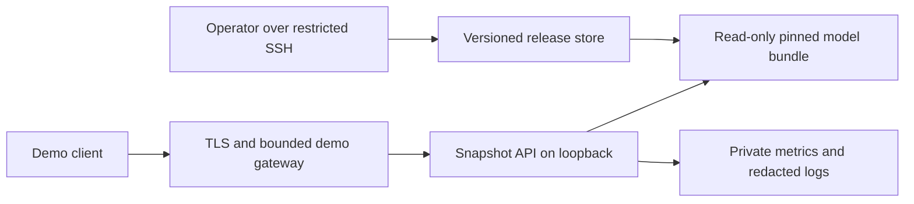

# Deployment design and cost decision

## Decision and implementation boundary

The current execution mode remains **local only**, with no new cloud subscription
or resource. The preferred zero-recurring-compute-cost investigation is OCI
Ampere A1 Always Free, conditional on actual account eligibility, capacity and
an independently qualified Arm implementation. **No cloud host is approved for
deployment.** The existing serving-process memory target is unchanged.

The [offline assessor](../scripts/assess_deployment.py),
[dated hosting catalog](../benchmarks/deployment/hosting_options_v1.json) and
[reproducible assessment](../benchmarks/deployment/deployment_assessment_v1.json)
implement the decision and resource/cost arithmetic. They do not call a cloud
API, use credentials, reserve capacity, install a proxy or provision resources.
The following target architecture and runbook are a design for subsequent work.

## Evidence used

| Evidence | Finding used in this decision |
| :--- | :--- |
| [Model bundle](MODEL_ARTIFACTS.md) | Components total 811,265,853 bytes; the bundle requires its compatible package and numerical libraries |
| [Linux qualification](LINUX_CONTAINER.md) | Linux/amd64 image and sealed references qualified locally with a 4 GiB container limit; no Arm or native cloud host qualified |
| [Release workflow](RELEASE_WORKFLOW.md) | Same-model local journal recovery and rollback exercised; public routing and off-host disaster recovery remain unimplemented |
| [HTTP capacity](HTTP_CAPACITY_REPORT.md) | Uncached 4 requests/s rejected 16/600 arrivals; primed-cache traffic does not establish production cacheability |
| [Reliability assessment](SERVICE_RELIABILITY_REPORT.md) | Sustained 600/600 and occupied-memory 180/180 succeeded; startup/lifecycle/recovery checks passed; RSS remains above 2 GiB |

The assessor pins all five input receipts by exact SHA-256 and checks shared
manifest/image identities, completion and resource arithmetic. Its maximum
observed serving RSS across the pinned capacity/reliability windows is
2,431,037,440 bytes, approximately **2.264 GiB**. This is separate from driver,
whole-host and cgroup memory. Those measurements came from Docker Desktop,
internal loopback, constructed reference traffic and the unchanged quotas.

The published M24 source and its complete-profile evidence reproduce from
`13cd614`. Adding subsequent tests does not update its frozen collection identity.
Hosted CI for that revision [passed](https://github.com/Thazg/ecommerce-recsys/actions/runs/39562065288).
No private real-qualification runner or cloud environment was configured.

## Hosting and monthly cost comparison

Prices and eligibility were checked on **2026-10-22**. The table reports known
monthly USD subtotals and advertised resources. These are conditional estimates,
not an all-inclusive bill, reservation or spending cap. Trial credits and free
hourly compute with a paid subscription are not treated as recurring free hosting.

| Option | Advertised memory | Known monthly subtotal | Assessment |
| :--- | ---: | ---: | :--- |
| Existing local snapshot | Existing owned host; no new capacity claim | $0 incremental cloud charge | Current private execution; hardware, electricity and internet excluded |
| OCI A1 Always Free | 12 GB, Arm; 2 OCPU | $0 within verified allowances | Preferred free investigation; current amd64 image cannot be transferred as Arm evidence |
| OCI AMD micro | 1 GB | $0 compute within allowances | Too small for the unchanged process |
| Google e2-micro free allowance | 1 GB | $0 compute within allowances | Too small; external IP, noneligible storage and transfer can add charges |
| Hugging Face Docker CPU Basic + personal PRO | 16 GB | $9 membership + $0 basic compute | Paid reference; creation membership and platform lifecycle matter |
| DigitalOcean Basic Regular | 8 GiB, 4 vCPU | $48 | Paid reference; fits the single-container reservation model, not the dual-container model |

Provider sources: [OCI Always Free](https://docs.oracle.com/en-us/iaas/Content/FreeTier/freetier_topic-Always_Free_Resources.htm),
[Google free allowances](https://docs.cloud.google.com/free/docs/free-cloud-features)
and [e2 resource sizes](https://docs.cloud.google.com/compute/docs/general-purpose-machines#e2_shared-core),
[Spaces eligibility](https://huggingface.co/docs/hub/en/spaces-overview)
and [membership pricing](https://huggingface.co/pricing),
[Droplet pricing](https://www.digitalocean.com/pricing/droplets).

Use the detailed current OCI allowance, rather than historical 4-OCPU/24-GB
examples. Home-region capacity and tenancy limits need verification; idle free
instances can be reclaimed. Do not upgrade the account or allocate billable
resources as an automatic workaround. The catalog treats unspecified GB as
decimal bytes conservatively; target-host available bytes must be measured.

The zero-cost OCI scenario assumes compute, boot storage, private artifact
storage and transfer all remain within the account's verified free allowances.
Optional domains, overages, taxes on paid services and operator time are outside
the subtotal. The Google row excludes an external IPv4 charge. The paid VM row
excludes backup subscriptions and overage. No existing account, domain, credit,
subscription or free resource availability is assumed. Quota controls and billing
alerts must be configured before provisioning; alerts alone are not a hard cap.

If free capacity cannot be obtained or Arm qualification fails, keep the local
snapshot and a recorded demonstration. A future static replay must identify its
recorded outputs; it cannot stand in for live API deployment or target-host tests.
Purchasing a host or changing the model requires a separate decision.

## Resource and storage budget

| Planning quantity | Calculation | Scope |
| :--- | :--- | :--- |
| Serving RSS target | 2 GiB | Existing charter; currently failed |
| Container reservation | 4 GiB | Existing qualification cap; not a measured RSS requirement |
| Host reserve | 2 GiB | Unmeasured allowance for OS, proxy, runtime and bounded collection |
| Single-container host floor | 4 + 2 = **6 GiB** | Maintenance stop/start planning floor |
| Two-container host floor | 2 × 4 + 2 = **10 GiB** | Temporary A/B coexistence reservation; CPU and startup peaks also need testing |
| Retained/staging model components | (3 retained + 1 staging) × 811,265,853 = **3,245,063,412 bytes** | About 3.022 GiB; excludes manifests, images, OS, logs and filesystem overhead |

The 12-GB Arm option clears these memory reservations on paper. This does not
validate its CPU, libraries, available memory, startup peak or latency. The
8-GiB paid reference clears only the single-container reservation. Provider GB,
OCPU, shared vCPU and cgroup limits are not interchangeable performance evidence.

Default proposed releases use **maintenance stop/start with visible downtime**.
There is no autoscaling, always-on promise or zero-downtime requirement. One
inference worker, cache off and busy rejection remain the baseline. Retain the
original security quotas. The local 1-request/s point is an input to planning,
not an external service objective. A larger host does not waive the 2-GiB target.

## Proposed exposure architecture

The following components are not installed or qualified by this design:



- The gateway and API share a network namespace; the API stays bound to
  `127.0.0.1`. The gateway alone owns the public listener. A container-bound
  loopback socket cannot be reached by merely publishing that API port from
  the host. A new supervised image/entrypoint and isolation contract are required.
- Only the bounded demo endpoint is public. Health, readiness, metrics, raw
  snapshot-user lookup, operator actions and Docker sockets stay private. A demo
  facade can map a finite set of example aliases to approved snapshot contexts;
  its input/output contract must be implemented and tested before exposure.
- Terminate TLS with an operator-controlled hostname/certificate plan. Its
  availability and cost are unresolved. Require authentication for the initial
  controlled deployment. A browser must never receive the backend shared token,
  cloud credentials, registry tokens or an unrestricted snapshot API credential.
- Validate the public Host/Origin and body/deadline/connection limits at ingress.
  Remove untrusted forwarded identity headers. The internal request uses the
  permitted loopback Host; a validated public Origin is handled at the gateway
  rather than forwarded into an incompatible local-only authority contract.
- All proxy traffic appears as one local peer to the unchanged backend. Its
  5-request/s peer quota therefore remains aggregate. Define finite gateway
  client/usage budgets separately; do not raise backend quotas or trust arbitrary
  `X-Forwarded-For`. Bound any gateway queue and preserve explicit 429/503/error
  outcomes without hidden recommendation fallbacks.
- Supervise both processes. Model readiness gates traffic; API failure must not
  leave a healthy-looking proxy. Stop admission, drain accepted work and then
  terminate the gateway. TLS, gateway overhead and client-network latency require
  new HTTP/load/security evidence; existing local receipts do not cover them.

## Artifact, secrets and operator delivery

1. Retain the current model, reference policy and upstream evidence unchanged.
   Arm requires a separate image, numerical dependency lock and prospective
   full-reference qualification. Do not run the amd64 image under emulation and
   report native Arm results. Do not widen numerical tolerances to obtain a pass.
2. Deliver candidate images and model components privately over restricted SSH,
   or a separately approved private object/registry channel. Registry credentials
   belong only to delivery tooling. Verify the archive checksum, loaded image
   content identity, external manifest pin and every model component after copy.
   A Docker image ID, registry manifest digest and archive checksum are distinct.
3. Stage on the destination filesystem, reject version overwrites, then publish
   the verified directory atomically. Keep at least three complete versions and
   a separate staging allowance. Do not embed raw data, training users/history
   tables or generated bundle files in the public source/image build context.
   Review dataset/model redistribution terms before any public artifact channel.
4. Keep bootstrap model copies and release descriptors off-host in a private
   location. Preserve verification code, source revision, locks and external pins
   needed for recovery; backing up only a manifest cannot reconstruct a model.
   Neither this assessment nor Git contains a backup of the generated bundle.
5. Deliver runtime secrets through root/operator-restricted files or an approved
   secret mechanism. Separate deployment credentials, backend shared credentials
   and public authentication. Never place secrets in CLI values, public build
   arguments, receipts, frontend bundles, logs or metric labels. Rotate after a
   suspected leak; a shared backend token provides no per-user authorization.

## Proposed release and incident runbook

| Stage | Required action | Failure behavior |
| :--- | :--- | :--- |
| Preflight | Verify current account/region/allowances, architecture, host resources, all pins, private backups, exposure configuration and free-storage headroom | Refuse provisioning/activation; keep current local execution |
| Stage | Privately transfer and verify complete image/model; reserve disk for retained versions and staging | Preserve previous release; remove only owned incomplete staging |
| Maintenance | Stop new public admission, show maintenance, drain old work and preserve the last known-good descriptor | Timeout/failure keeps maintenance active; do not claim graceful stop |
| Candidate | Start one new pinned instance; verify live/ready, exact output/pool/route contracts and declared numerical checks | Refuse traffic and stop owned candidate; retain journal and diagnostic evidence |
| Activate | Record target-host verification, then route to the qualified candidate | Any ambiguous state requires explicit recovery, not guessed success |
| Rollback | Stop failed candidate, restart previous pinned version, recheck readiness and references, then restore routing | If previous release also fails, remain unavailable and notify operator |
| Restore | Recreate a lost host from off-host code/image/model/pins and re-run complete qualification | Reclaimed capacity or missing backup can cause an unbounded outage; no RTO/RPO is certified |

The M22 controller remains frozen for its local channel. Its network-none,
amd64-qualified descriptors cannot be repurposed as cloud/Arm/public-routing
approval. A target adapter needs its own descriptor, journal, process ownership,
cleanup and rollback tests. Test actual process/daemon/host recovery at its
declared scope. Monitor readiness, 429/503/error fractions, worker occupancy,
RSS, disk, startup and certificate expiry with bounded labels and redacted logs;
verify an operator can actually receive an alert.

## Required gates before controlled deployment

| Gate | Current state | Required evidence |
| :--- | :--- | :--- |
| Process memory | Failed | Optimize with unchanged outputs, or prospectively approve a justified budget/scope revision; never edit old receipts |
| Account, region and zero-cost allowance | Unverified | Actual account entitlement, available free capacity, storage/network plan and explicit cost approval for any nonfree item |
| Arm/native target | Unqualified | New pinned build/lock, imports, safe load, exact output/eligibility and prospectively specified numerical checks |
| Public gateway, auth and TLS | Design only | Implemented access/secret/authority/rate/deadline rules, fault tests and new source-pinned HTTP evidence |
| Delivery and recovery | Local evidence only | Private artifact transfer plus restore/rollback on selected host, verified off-host backups and owned cleanup |
| External performance and observability | Unmeasured | Predeclared warm/cold/K/cache workload, all outcomes, external latency and process/host resources; real alert delivery |

No implementation task, hosting comparison or passing local parity changes these
gates. The existing later offline folds remain post-selection diagnostics; a
cloud demo would not establish new recommendation quality or business benefit.

## Reproduction

Run with the existing ecommerce-recsys environment and a clean copy of the
published upstream receipts. No Retailrocket data, model fit, Docker daemon,
cloud account, credentials or network access is needed for the assessor:

```powershell
python scripts/assess_deployment.py --check benchmarks/deployment/deployment_assessment_v1.json
python scripts/assess_deployment.py --output .local/deployment-repeat.json
pytest tests/unit/test_deployment_assessment.py
```

The output is deterministic for the same source, catalog, policy and receipts.
Fresh outputs use atomic, non-overwriting publication. Price/term changes require
a reviewed new catalog and distinctly named assessment. The tool checks supplied
dated facts; it does not fetch live prices, validate an account, certify a bill
or make provider documentation immutable. Source and documentation revisions
remain separate from actual cloud qualification.
