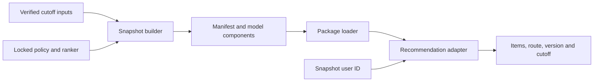

# Versioned offline model artifacts

## Purpose and policy

The artifact boundary separates model fitting from recommendation inference.
A fitted snapshot can be loaded by the installed `ecommerce_recsys` package
without importing benchmark scripts, reading training datasets or calling `fit`.
Inference requires compatible `recommendation`, `retrieval` and `ranking`
implementations from the installed package and its numerical dependencies.
Refactoring those implementations requires compatibility validation or a new
verified bundle; this is independence from the training pipeline.
This packages the [locked offline reference](MODEL_POLICY_REPORT.md):



| Request | Route | Output |
| :--- | :--- | :--- |
| User present in the snapshot | Five-source hybrid, frozen learned ordering, no category bonus | Up to 20 unseen catalog items |
| Unknown user or absent user ID | Explicit recent-popularity source | Up to 20 catalog items |

The warm sources are ItemKNN, exact ALS, category popularity, recent popularity
and global popularity. Each requests up to 1,000 candidates; fusion retains
their scores and ranks with RRF constant 60. The final linear scorer uses the
published 32-feature order, transforms, RMS scales and weights. The fixed ALS
configuration has 128 factors, 40 iterations, regularization 0.01 and seed 42;
ItemKNN uses 20 neighbors, minimum five interactions and shrinkage 100.

The default bundle, `retailrocket-fold09-v1`, uses the fold-9 training cutoff.
Its ranker was trained on labelled folds 1–4, whose final label window ends
before this snapshot cutoff. The build permits folds 5–9 with this model.
This is a historical snapshot, not a model updated to the date of the build.

## Persisted state

| Component | Format | Inference role |
| :--- | :--- | :--- |
| User/item factors | Float32 NPY | Exact ALS dot products; read-only memory maps on load |
| User/item mappings and aggregates | Parquet | Sorted IDs, counts, distinct counts, last-event times and event-type counts |
| Full seen-item rows | Integer NPY arrays | Sparse row pointers and sorted item indices; filter the entire snapshot history |
| Item metadata and recent counts | Parquet | Categories as-of cutoff, global/recent popularity and category source lists |
| ItemKNN neighbors | Parquet | Original neighbor order, raw similarity and co-occurrence support |
| User/category affinities | Parquet | Cutoff-time ranking predictors |
| Ranker weights/scales | Float64 NPY | Inference-only linear scoring; no optimizer or labels |
| Producer reference requests | JSON | Label-free evidence, feature, score and output round-trip checks |

Raw events and future targets are not serialized. The bundle retains snapshot
user IDs, seen sets and aggregate behavior for known-user inference, so generated
versions stay outside Git. Source adapters isolate compatibility with the
historical model classes; they expose their direct candidate behavior and do
not reconstruct a general-purpose fitted `implicit` training object.
Seen sets suffice for these five order-independent sources. This format does
not preserve the event sequence required by the separate Two-Tower or
sequential experiments, which are outside the locked reference route.

## Manifest and loading contract

`model_manifest.json` schema 1 records the version, cutoff, population, source
configurations, seeds, feature order, routes, input and upstream policy hashes,
producer/runtime code identities and exact dependency versions. Each of eleven
components has a byte length and SHA-256; arrays also have shape/dtype, and
tables have row counts and Arrow schemas. The canonical manifest content digest
excludes only its own digest field. A separate external SHA-256 pins the exact
manifest file bytes.

Loading rejects missing/extra files, symlinks, nested paths, unsupported schema,
policy, feature order, code or numerical environment. All component byte hashes
are checked before model-array or table deserialization. NumPy loading always
uses `allow_pickle=False`. Semantic checks then enforce finite factors/weights,
positive scales, unique ordered mappings, consistent sparse history and feature
counts, valid neighbors, and timestamps no later than the declared cutoff.
Checksums detect accidental changes; they do not authenticate a publisher.
Use a manifest digest obtained from a trusted receipt to pin a release.

Runtime fingerprints cover an explicit list of package dependencies rather than
unrelated future modules. Loading requires the recorded Python major/minor
version and exact numerical-library versions; Python patch changes are allowed.
OS and machine differences emit a compatibility warning rather than rejecting
the bundle. Host metadata remains recorded unchanged. Cross-host loading still
requires prediction-parity and resource validation before deployment. Linux
execution of this full Windows-built snapshot has not been verified; the tests
simulate host metadata changes and are not Linux deployment evidence.

The reader supports one explicitly reviewed schema-1 predecessor while its
prediction AST, policy, feature order and inference dependency hashes remain
unchanged. Unknown or numerically changed implementations are rejected.
The original manifest and its SHA remain unchanged; a separate
[loader receipt](../benchmarks/artifacts/fold09_loader_v1.json) binds the current
reader to the original bundle and quality receipt. This limited reader
compatibility does not make arbitrary refactors compatible or relax producer
provenance checks.

## Build and resume

Run from the repository root with the existing `ecommerce-recsys` environment:

```sh
python -m scripts.build_model_artifacts --version retailrocket-fold09-local-v1 --receipt .local/model_bundle_validation.json
python -m scripts.verify_model_artifacts artifacts/retailrocket-fold09-local-v1
```

For the existing measured reference bundle, verify the pinned manifest and
optionally bind the original quality receipt without training or reevaluation:

```sh
python -m scripts.verify_model_artifacts artifacts/retailrocket-fold09-v1 --manifest-sha256 84ddc7b2e34b92728164f60346e2115cdcc07415af72aed60859c78ffbb5aabe --quality-receipt benchmarks/artifacts/fold09_v1.json --output .local/loader_validation.json
```

The builder first verifies the published rolling inputs, sweep/selection locks,
ranker model, feature audit and complete policy provenance. It fits the sources
once using interactions at or before the selected cutoff, captures 100
deterministic snapshot-user reference requests plus one cold request, and
serializes to a sibling staging directory. After writing the manifest last and
checking the inventory, it renames the sealed directory into the absent version
path. Existing versions are never overwritten or merged with a new fit.

A matching published bundle or sealed staging directory can resume without
source fitting using the same producer implementation. After changing producer
code, verify an existing bundle with the standalone loader; write any new build
to distinct version and receipt paths, as in the local-build example above.
The full builder retains the upstream benchmark's original environment guards;
the compatible inference reader does not relax them.
An incomplete staging directory is retained for inspection;
the builder refuses to mix it with a subsequent fit. Quality validation writes
an atomic checkpoint every 500 warm requests, bound to manifest bytes, target
file hashes and evaluator code. These checkpoints and measured build costs stay
outside Git; the completed validation receipt is tracked.

JSON writes flush and `fsync` the temporary file before replacement and attempt
cleanup on handled failures; filesystem errors can prevent cleanup. Forced
termination or power loss can leave `.tmp` files
or incomplete staging. Directory entries and every NumPy/Parquet component are
not explicitly synced, so atomic publication does not guarantee durability
across power loss. Incomplete staging is refused on resume rather than silently
merged into a new fit.

An intentional new snapshot or implementation uses distinct paths:

```sh
python -m scripts.build_model_artifacts --fold 8 --version retailrocket-fold08-v1 --receipt benchmarks/artifacts/fold08_v1.json
```

Changing an output version does not authorize changing the locked policy.
The ranker optimizer is not rerun by the builder.

## Python inference

```python
from ecommerce_recsys.artifacts import load_bundle

model = load_bundle(
    "artifacts/retailrocket-fold09-v1",
    expected_manifest_sha256="<manifest_sha256 from the validation receipt>",
)
result = model.recommend("known-user-id", k=10)
print(result.items, result.route, result.bundle_version, result.cutoff)
```

IDs are nonempty strings or integers; `None` selects cold context. Boolean,
floating-point and null-like IDs are rejected. Output limits are plain integers
from 1 through 20. Smaller limits are prefixes of the same Top-20 order.
Unknown IDs take the cold route rather than creating synthetic personalized
features. Catalog/seen eligibility and score/item-ID ties match the benchmark.

The adapter looks up the user's complete snapshot seen set and stored feature
aggregates. It accepts no dynamic history update, new item or post-cutoff
feature. An empty eligible route may return fewer items; there is no hidden
backfill. The API returns immutable item tuples and version/cutoff metadata.

## Verification evidence

### Fold-9 snapshot

| Property | Value |
| :--- | ---: |
| Training cutoff, Unix milliseconds | 1,441,216,678,608 |
| Training interactions | 2,480,638 |
| Snapshot users | 1,265,556 |
| Snapshot catalog items | 224,190 |
| Serialized component bytes, excluding manifest | 811,265,853 |
| Serialized components, MiB | 773.68 |
| ALS factor arrays, MiB | 727.42 |
| Exact label-free reference requests | 101 |

The cutoff is 2015-09-02 17:57:58.608 UTC; the ranker's latest training-label
window ends at 2015-07-09 14:48:20.061 UTC. Source fitting took 515.31 seconds
in this local run, with another 29.10 seconds for export. These separate phases
exclude upstream verification, feature preparation, reference requests, loading
and full quality evaluation; their sum is not total pipeline wall time.
The original reader's first measured load took 20.97 seconds; that reader hashed
component bytes twice. The current reader hashes each component once before
deserialization; schema and semantic checks remain in place. An isolated interpreter launched
from outside the repository also verified all 101 reference traces with the
manifest digest pinned. The reproduction command is the verifier above; its
standalone script imports only the installed package.
The subsequent [loader verification](../benchmarks/artifacts/fold09_loader_v1.json)
records a 20.10-second local load and 101 exact reference matches with the same
manifest and components. These are individual measurements under uncontrolled
filesystem cache and host load, not a paired speed comparison.

The [fold-9 receipt](../benchmarks/artifacts/fold09_v1.json) binds component and
manifest hashes, build/load cost, reference parity and loaded quality counts.
Validation compares the loaded warm and cold routes with the corresponding
fold of the frozen policy diagnostic, retaining unreachable targets in both
primary denominators. Exact pool, evidence, transformed-feature, score and
Top-20 trace hashes are checked on producer references before full evaluation.
Full-fold checks reconcile candidate availability, all Top-5/10/20 hits,
MRR/NDCG numerators, coverage and category-slot counts.

### Loaded quality reconciliation

| Cohort | Targets | Reachable | Target in pool | Hits@5 | Hits@10 | Hits@20 | HR@20 | NDCG@20 |
| :--- | ---: | ---: | ---: | ---: | ---: | ---: | ---: | ---: |
| Warm | 13,539 | 12,564 | 2,754 | 361 | 511 | 669 | 0.049413 | 0.024478 |
| Cold | 142,024 | 132,969 | 18,745 | 1,077 | 1,316 | 1,867 | 0.013146 | 0.007247 |

All counts, MRR/NDCG numerators, output coverage and category-slot totals match
the corresponding frozen policy fold. Primary rates retain all cohort targets,
including unreachable items. Warm and cold use separate denominators. Loaded
quality evaluation took 1280.00 seconds, including trace hashing and
quality accounting; this is not an inference latency benchmark. A repeat run of
the original producer validated the immutable bundle and resumed its completed
quality checkpoint without source fitting. The current reader's separate
verification retains the same components and matches the exact reference
traces; it does not recompute this full-fold quality table.

Unit tests use actually fitted tiny sources, not a constant mock retriever.
They also run an isolated Python process outside the repository working
directory with `scripts` imports disabled. Failure-path tests cover malformed
state after recomputing checksums, version collisions and sealed/partial
resume. Symlink creation is tested where the operating system permits it.

## Limits

This work establishes a durable offline inference boundary. It adds no new
accuracy claim: fold 9 belongs to the previously inspected diagnostic period,
and save/load parity is engineering verification, not independent validation.
The cost-heavy ALS route remains the accuracy-selected reference documented
in the policy report; packaging does not justify it under a serving budget.

Load time includes checksum/schema/semantic verification and state restoration.
It is a single local load after writing the bundle; filesystem cache state is
not controlled, so it is not a cold-start guarantee.
Restoration builds Python mappings for 1,265,556 users and 224,190 items and
iterates through stored KNN neighbors. Read-only factor maps do not remove
these dictionary/table costs. Loading can take tens of seconds and substantial
process memory; this artifact boundary is not a cold-start serving design.
Factor-array bytes and serialized component bytes are not whole-process memory.
Loaded quality evaluation time includes diagnostic trace construction and
quality accounting; it is not serving latency. Numerical calls use one thread,
and `threadpoolctl` changes process-wide worker limits. Concurrent request
handling has not been validated. HTTP serving, request-time updates, cache,
deployment, live fallback orchestration and online confirmation are not
implemented by this artifact layer.
