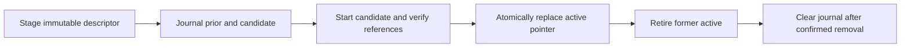

# Controlled snapshot release

## Scope and evidence

The release tools manage **isolated local qualification** of the unchanged
Retailrocket snapshot. They add immutable release descriptors, candidate
verification, an atomic active pointer, deferred-retirement recovery and explicit rollback.
The containers have no network or published ports. The pointer selects a local
container for operator checks; it does not switch public traffic.

| Evidence | Scope |
| :--- | :--- |
| [Linux CI reproduction](../benchmarks/release/ci_linux_preflight_validation_v1.json) | Hashed CPU dependencies, workflow lint, unit and fitted-process profiles on Docker Desktop Linux/amd64 |
| [Release exercise](../benchmarks/release/release_workflow_preflight_validation_v1.json) | Actual original bundle/image, candidate rejection, committed cleanup recovery, process-crash rollback and final stop |
| [Upstream container qualification](../benchmarks/containers/linux_snapshot_boundary_validation_v1.json) | Original model inventory, Linux numerical portability, HTTP references, isolation and startup faults |

The [boundary CI receipt](../benchmarks/release/ci_linux_boundary_validation_v1.json)
and [boundary release receipt](../benchmarks/release/release_workflow_boundary_validation_v1.json)
retain their original source and bytes. They predate the explicit invalid-descriptor
exercise, mandatory external verifier storage and tightened runtime-policy checks.

The [acceptance CI receipt](../benchmarks/release/ci_linux_acceptance_validation_v1.json)
and [acceptance release receipt](../benchmarks/release/release_workflow_acceptance_validation_v1.json)
retain their original source and bytes. The current preflight checks additionally
protect bundle/interpreter paths before checkout, enforce the real-lane Python
patch and reject noncanonical qualification field types.

These are separate from a GitHub-hosted execution. The new GitHub workflows are
implemented and validated locally; a protected runner/environment and a remote
qualification run have not been configured or observed. No image registry,
GitHub release, public deployment or new model-quality result is published.

The [initial CI receipt](../benchmarks/release/ci_linux_validation_v1.json) and
[initial release receipt](../benchmarks/release/release_workflow_validation_v1.json)
retain their original source identity and bytes. They predate compound-failure
recovery, external workflow storage and mandatory final-drain evidence; they
are historical checks, not evidence for the current implementation.

## CI profiles

The [hosted workflow](../.github/workflows/ci.yml) runs on pushes and pull
requests targeting `main`, using Ubuntu 24.04 and Python 3.13.15. It has
read-only contents permission, a deadline and per-ref cancellation. Official
Actions use full verified commit SHAs. Checkout does not retain credentials.

`requirements/ci-linux.txt` pins 47 Linux/amd64 binary wheels and their SHA-256
hashes, including service test dependencies, Ruff, PyYAML, CPU Torch and Faiss.
The latter two enable the existing experiment tests; they do not add a retrieval
source or change the serving image. Installation retains every frozen runtime
and build wheel pin, then installs this package without dependency resolution.

The workflow checks imports, `pip check`, actionlint 1.7.12 with a verified
archive checksum, finite workflow policy, Ruff lint/format, unit tests and the
fitted-process integration profile. JUnit validation rejects failed, duplicate,
empty, foreign and unexpected skipped coverage. CPU model tests cannot silently
skip; only the named Windows symlink-privilege exception is allowed when these
profiles run on Windows. The real-bundle case is deliberately outside fixture CI.

For the same fixture profiles in the configured Windows environment:

```powershell
python -m pytest tests/unit tests/integration -m "not real_bundle" -q
python scripts/check_release_workflows.py
python -m ruff check .
python -m ruff format --check .
```

Only selected JUnit files upload, with seven-day retention. Model components,
private arrays, raw data and private logs are outside that upload. The workflow
checker protects the declared configuration; it is not a sandbox for arbitrary
untrusted workflow code and does not replace review.

For a local reproduction, first obtain the locked wheels using **Linux/amd64,
Python 3.13.15**. A Windows wheel download does not satisfy these hashes. Obtain
the official Linux actionlint archive; the verifier checks its pinned checksum.
The unchanged qualified `recsys-snapshot:qualification` image must exist locally.

```powershell
python scripts/verify_ci_profile.py --wheelhouse .local/ci-wheelhouse --actionlint-archive .local/actionlint_linux_amd64.tar.gz --output .local/ci-repeat.json
```

The verifier builds a separate disposable test image with offline wheel
installation. `identity.ci_inputs_sha256` records the actual build/test inputs,
including package metadata, code, test configuration and frozen fixture artifacts.
Documentation and the CI/release receipts generated by these gates are excluded
from staging and this inventory; it is not a full-public-tree snapshot. The
separate 12-file canonical-LF identity binds the gate implementation. Only public
build/test source is staged; Git credentials, model/data files,
agent instructions and private state are excluded. The test workspace is
writable, unlike the serving container. It runs both profiles without a real
model mount and confirms owned container removal before publishing success.
This Docker Desktop reproduction is not an Ubuntu-hosted runner attestation.

## Gated real qualification

The [snapshot workflow](../.github/workflows/snapshot-release.yml) is reusable
only from a same-owner **private operations repository**, manually dispatched
on its `main`. Keep its persistent self-hosted runner separate from source-repo
pull requests, including if the source repository later becomes public. Labels
or a job condition alone are not a runner security boundary.

Before enabling the lane, an operator must provide:

- A trusted Windows x64 runner, version 2.327.1 or newer, dedicated to the
  private caller and labelled `snapshot-qualification`; Docker Desktop Linux
  and enough RAM for two model instances during transition are required.
- A `snapshot-qualification` environment with required review, restricted
  deployment branches and operator access. Verify that the account plan supports
  those protections. Merely naming an environment in YAML does not enable them.
- Environment variables `SNAPSHOT_PYTHON` and `SNAPSHOT_BUNDLE`, pointing to the
  original `ecommerce-recsys` Python environment and an external complete bundle.
  The bundle and interpreter must be absolute paths physically outside the runner
  checkout; this is checked before checkout cleaning. Install the normal development
  and serving test requirements plus `requirements/release-test.txt`; CPU
  Torch/Faiss imports are required. No fallback environment is selected.
- An absolute external `SNAPSHOT_WORK_ROOT`, outside the checkout after physical
  path resolution. Before checkout, each attempt creates a fresh
  `github-<run-id>-<attempt>` directory there. Receipts, JUnit, release stores and
  recovery journals use that directory, so checkout cleaning cannot erase them.
  Qualification refuses prior attempts with pending journals or active/retained
  instances until an operator recovers/stops them using their frozen source.
- Explicit source read access: the source repository is currently private.
  Pass a read-only source credential as `source_read_token`, with contents and
  Actions metadata read permissions. Configure cross-repository reusable-workflow
  access separately. Do not put credentials in CLI values, source files or receipts.

The credential is scoped to source metadata checks and checkout, not model/test
commands. Checkout removes persisted credentials. The lane verifies that the
requested 40-character SHA equals current source `main` and that its latest
matching push CI attempt completed successfully. Pending or failed reruns do
not fall back to an earlier green attempt. Metadata access failures fail closed.

A private caller can use the following structure. Replace the literal workflow
pin with a reviewed full commit SHA and pass that same SHA as `source_sha`.
Do not run it until the environment, access and runner restrictions are reviewed.

```yaml
name: Qualify snapshot
on:
  workflow_dispatch:
    inputs:
      source_sha:
        type: string
        required: true
permissions:
  contents: read
jobs:
  qualify:
    uses: Thazg/ecommerce-recsys/.github/workflows/snapshot-release.yml@REVIEWED_40_CHARACTER_SHA
    with:
      source_sha: ${{ inputs.source_sha }}
      local_qualification_only: true
    secrets:
      source_read_token: ${{ secrets.SNAPSHOT_SOURCE_READ_TOKEN }}
```

The called job enforces the exact Python patch, dependency imports and original
manifest pin, then runs original-producer functional profiles, creates fresh full
[Linux evidence](LINUX_CONTAINER.md), then exercises the local release controller.
Calls are serialized without automatic cancellation. Only the two completed
receipts and two JUnit reports can upload. A cancelled or killed job may leave
external private recovery state, preserved across later checkouts; there is no remote production promotion step.

GitHub's [secure-use guidance](https://docs.github.com/en/actions/reference/security/secure-use)
explains immutable Action pins and self-hosted runner risks. Its
[reusable-workflow reference](https://docs.github.com/en/actions/reference/workflows-and-actions/reusing-workflow-configurations)
describes caller-context runner access. Repository access, runner groups and
environment review are operator prerequisites, not settings established here.

## Immutable release identity

`scripts/snapshot_release.py` creates a private store with:

```text
releases/<id>.json       immutable descriptor and checksum
evidence/<sha>.json     exact externally pinned Linux qualification
active.json             generation, active/previous and retained instance ownership
pending.json            prior/target states, reserved candidate name and phase
operation.lock          OS-owned process lock
logs/                   private Docker output
```

A descriptor binds the channel `local-qualification`, image content ID, model
manifest/version, upstream evidence SHA and canonical-LF controller/config/test
identity. Qualification requires boolean startup flags and an integer graceful
cleanup count; numeric equivalents are rejected. Staging rejects incomplete, stale or foreign evidence and never
overwrites a release ID. The loader checks the original model inventory; no
training or component replacement is performed. Preserve the same controller
checkout while operating a store: changed code requires new qualification and
an explicit store migration, rather than a hash override. Stores cannot be moved
to another path because ownership includes their resolved absolute location.

The active record pins the descriptor and exact container ID/name. Every Docker
operation checks image, store/release labels, runtime isolation and name scope.
A process-owned nonblocking lock serializes operations and is released by the
OS if its owner dies. It is not a distributed or multi-host coordination scheme.
The store assumes trusted local operator permissions, not hostile concurrent
filesystem writers.

## Activate, recover and roll back



Candidates preserve the qualified non-root/read-only/network-none/resource
configuration. Readiness plus all 101 HTTP references, prefix/denial checks and
the qualified output digest must pass before pointer publication. The controller
rechecks readiness immediately before commit. It retains the former active until
that point; full reference execution can take longer than a simple health probe.

Before commit, failure cleans only the candidate and preserves the prior pointer.
After commit, cleanup failure keeps the new pointer and journal; subsequent
operations require explicit recovery. Recovery accepts the exact prior/target
state or its strictly derived deferred-retirement state. Ambiguous state or
foreign ownership stops cleanup rather
than guessing which release to use.

If the committed target dies while retirement is still pending, `recover`
atomically records the former active as retained and clears the journal only
after the retained ownership record is published. It removes no container and does not claim the dead
target is healthy. Repeating recovery after interruption between pointer write
and journal removal is safe. Explicit rollback then verifies a fresh previous
instance and retires both the failed target and every retained former active.
Failed rollback candidates leave retained instances untouched. `stop` can also
retire owned instances explicitly. Retained ownership is bounded to 16 entries;
ambiguous, foreign or over-budget inventory fails closed.

Rollback starts and verifies a fresh instance of the previous descriptor. It
also works when the active process is unhealthy or has exited. A former active
that already crashed is removed with an explicit abnormal-exit record; this is
not reported as graceful drain. A running former active must complete the owned
SIGTERM cleanup within the deadline; otherwise the journal remains for inspection.

Run commands from the frozen repository in `ecommerce-recsys`, with Docker
Desktop Linux running. Use the original sealed bundle and a trusted qualified
receipt; computing a file hash identifies that file but does not establish trust
in an arbitrary receipt.

```powershell
$bundle = 'E:/ecommerce-recsys/artifacts/retailrocket-fold09-v1'
$store = 'D:/recsys-operations/local-snapshot'
$workRoot = 'D:/recsys-operations/qualifications'
$qualification = 'benchmarks/containers/linux_snapshot_boundary_validation_v1.json'
$pin = (Get-FileHash -LiteralPath $qualification -Algorithm SHA256).Hash.ToLowerInvariant()
python scripts/snapshot_release.py --store $store --bundle $bundle stage --release-id local-reference-a --qualification $qualification --qualification-sha256 $pin
python scripts/snapshot_release.py --store $store --bundle $bundle activate --release-id local-reference-a
python scripts/snapshot_release.py --store $store --bundle $bundle status
# Stage and activate another reviewed descriptor before exercising rollback.
python scripts/snapshot_release.py --store $store --bundle $bundle rollback
python scripts/snapshot_release.py --store $store --bundle $bundle stop
```

If `pending.json` remains, inspect the private journal/logs and run `recover`
instead of deleting or editing state. Missing Docker access, ambiguous
pointers, changed code/model or failed removal confirmation
remain errors. Do not manually patch descriptor or receipt checksums.

Every release-verifier invocation requires an absolute external `--work-root`;
there is no checkout-local fallback. To repeat the complete controlled exercise
into a fresh output:

```powershell
python scripts/verify_release_workflow.py --bundle $bundle --qualification $qualification --qualification-sha256 $pin --output .local/release-repeat.json --work-root $workRoot
```

## Recorded results and limits

The current acceptance checks on 2026-10-20 record:

| Check | Result |
| :--- | :--- |
| Windows unit / fitted-process profiles | 945 / 7 passed; one named symlink skip |
| Linux unit / fitted-process profiles | 946 / 7 passed; no skips |
| New boundary/transaction tests | 120 passed, included in these totals |
| Immutable descriptors | Two IDs; identical qualified image/model |
| Successful activations | A, B and fresh rollback A; each matches all 101 HTTP references plus prefix/denial checks |
| Invalid descriptor activation | A new scratch descriptor has a valid JSON checksum but a mismatched manifest; activation rejects it with pointer, journal, container inventory and A health unchanged |
| Wrong qualification pin / readiness observer failure | Rejected; prior active pointer unchanged |
| Postcommit retirement observer failure | Journal retained; target death defers retirement with former active still owned |
| Active-process SIGKILL | B exits with code 137 while journal remains; recovery retains old A, then fresh A verifies before rollback commit |
| Abnormal former-active retirement | Explicit record; not counted as graceful cleanup |
| Final stop / owned containers remaining | Exactly one verified graceful cleanup event / zero |
| Deployment eligibility / new GitHub workflow execution | False / unobserved |

Both fixture commands deselect the opt-in real-bundle test; it is not counted as
executed. The separate release exercise actually loads and serves the original
model. Source/lock/workflow identities are recorded in both new receipts, and
all upstream model and verification evidence remains unchanged.

The two exercise descriptors use **the same image and model**. This tests release
control and recovery, not a model improvement or different-version compatibility.
Each successful candidate repeats the same 100 warm/one cold references, rather
than adding independent users or new recommendation-quality measurements.
The invalid descriptor is a new scratch metadata fixture with a mismatched
manifest identity and a valid JSON checksum; the valid descriptors and original
bundle remain unchanged. It is rejected before creating a candidate container.
The readiness/retirement failures are deliberately controlled observer faults;
the active-process SIGKILL is a real owned container failure, injected before
recovery of its pending retirement. Success publication independently requires
final `graceful=true`, exactly one cleanup event and no abnormal final exit. None simulates a
Docker-daemon failure, host power loss or target-host disaster recovery.

Atomic file replacement and file fsync do not certify power-loss durability
across directory entries and Docker state. Unpublished temporary files or images
may remain after a killed build; no global image prune is performed. Candidate
and active containers coexist temporarily, so their combined memory needs
headroom beyond one 4 GiB container cap. Resource limits are not memory-budget
acceptance: measured serving RSS still exceeds 2 GiB.

No public traffic router, zero-downtime guarantee, registry delivery, concurrent
load SLO or production rollback is established. Deployment eligibility remains
false. The [roadmap](ROADMAP.md) keeps representative load, target-host recovery,
memory/cost qualification and controlled deployment as later gates. Existing
folds 5–9 remain post-selection diagnostics; this operational work does not make
them blind validation.
